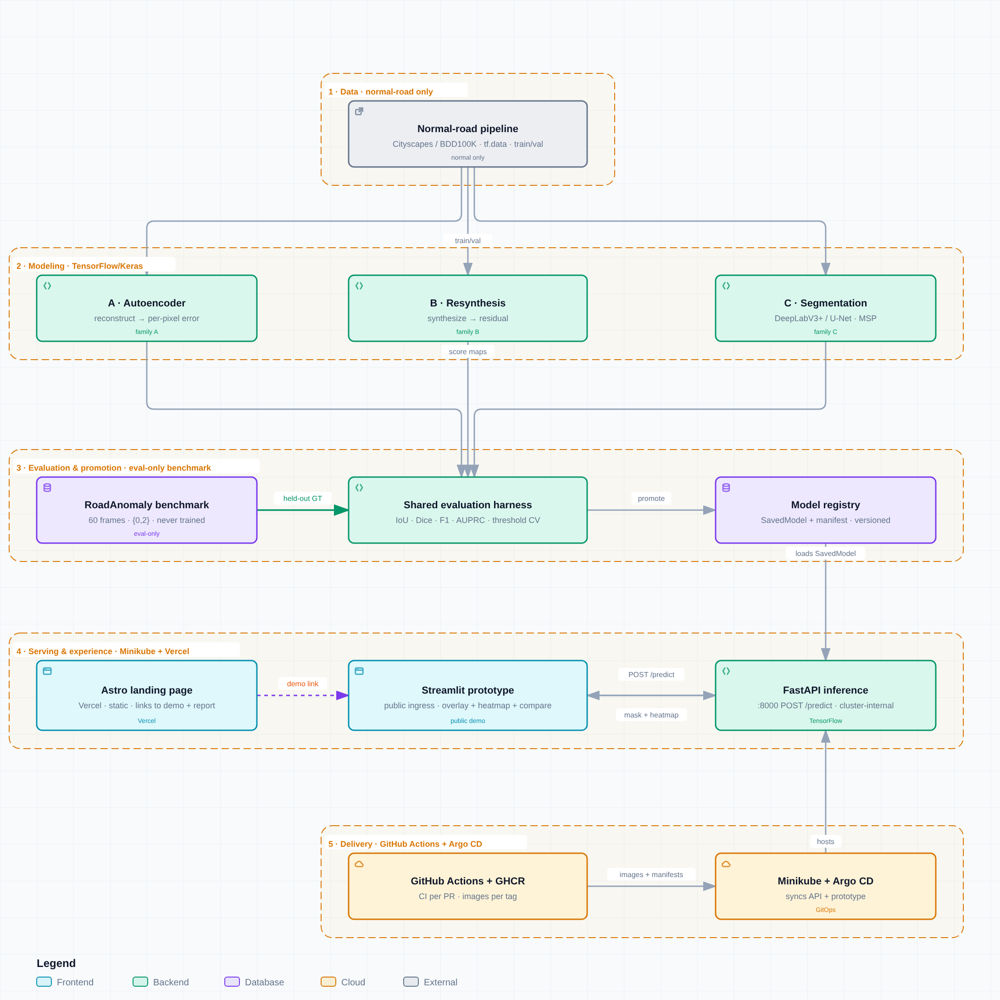

<div align="center">

# RoadAnomaly — Pixel-Level Road Anomaly Detection

*Deep Learning module project · CNNs, image resynthesis, transfer learning and autoencoders*

**Finding the unexpected on the road: animals, cones, boulders, debris and other
objects that a driving perception stack was never trained to expect.**

[](https://github.com/adriansalvadorekomo/RoadAnomaly/actions/workflows/ci.yml)
[](https://github.com/adriansalvadorekomo/RoadAnomaly/actions/workflows/cd.yml)
[](LICENSE)
[](data/credits.txt)
[](pyproject.toml)
[](frontend/)
[](pyproject.toml)

</div>

---

## Architecture

<picture>
  <source media="(prefers-color-scheme: dark)" srcset="assets/architecture-dark.png">
  
</picture>

Three bands, one system. **Deep learning pipeline** — normal-road corpora pre-train three
models, RoadAnomaly is scored held-out. **Serving stack** — exported
TorchScript/ONNX artifacts load into FastAPI, which returns masks and heatmaps
to the Next.js dashboard. **Delivery** — GitHub Actions gates every pull
request and publishes tagged images to GHCR that the compose stack runs.

The diagram is generated from [`docs/assets/architecture.json`](docs/assets/architecture.json)
with [archify](https://github.com/tt-a1i/archify); open
[`architecture.html`](docs/assets/architecture.html) for the interactive version
(pan, zoom, dark mode, guided tours). Regenerate it from the spec rather than
editing the HTML — the HTML is a build artifact.

---

## The problem

A segmentation model trained on Cityscapes or BDD100K predicts a closed set of
classes: road, car, pedestrian, sky. Anything else — a deer on the asphalt, a
ladder that fell off a truck, a boulder around a bend — is either absorbed into
the nearest known class or ignored, and at 50 km/h "ignored" is an incident.

Road anomaly detection reframes this as **per-pixel out-of-distribution
detection**: produce a score map where high values mean *this pixel does not
belong to anything I was trained to recognise*. The model is never given an
"anomaly" class to learn. It is given normal driving scenes and has to notice
when the world stops matching them.

That reframing is why the dataset is unusual, and why the protocol below matters
more than the model choice.

---

## The dataset

`data/` is tracked in this repository (15 MB) so a clone is reproducible. Every
number in this table is asserted by
[`tests/test_dataset_integrity.py`](tests/test_dataset_integrity.py) — if the
dataset is ever swapped, CI fails rather than letting the documentation drift.

| Property | Value |
|---|---|
| Images | **60** frames, `data/frames/*.webp`, all **1280 × 720**, RGB |
| Index | `data/frame_list.json` — frame order used by every loader |
| Annotation dirs | **60** — one `<frame>.labels/` per frame, so the pairing is exact |
| Semantic masks | `labels_semantic.png`, uint8, **{0 = normal, 2 = anomaly}** in all 60 |
| Colour masks | `labels_semantic_color.png` — black = normal, orange `#FF4500` = anomaly |
| Instance masks | `labels_instance.png` in **46** frames; pixel value = instance id |
| Instances | **201** bounding regions, **all `cls = 2`** (one anomaly class, no sub-labels) |
| Semantic-only frames | **14** — e.g. `animals06`, `cones07`, `obstacles01/02`, annotated but with no instance masks |
| Anomaly coverage | **9.8 %** of all pixels; per frame: **0.4 % → 42.3 %** (median 6.6 %) |
| Object scale | median instance ≈ **87 × 87 px**, but **35 of 201 instances** are smaller than 32 × 32 px |
| Categories | animals 31 · obstacles 15 · cones 8 · lost_tires 3 · vehicle 3 |
| Attribution | [`data/credits.txt`](data/credits.txt) — per-image author, source and licence |

**Category distribution** (by frame-name prefix, the natural scene grouping):

```
animals     31  ███████████████████████████████
obstacles   15  ███████████████
cones        8  ████████
lost_tires   3  ███
vehicle      3  ███
```

**Inside a label directory.** The annotation tooling (the authors' own
[LabelGrab](https://github.com/cvlab-epfl/LabelGrab)) left three kinds of file.
We use the first two:

- `labels_semantic.png` / `_color.png` / `labels_instance.png`, `index.json` —
  **used**: masks, instance ids, and per-instance `crop_rect` / `roi_rect` boxes.
- `instance_XXX_gc_mask.png` + `instance_XXX_gc_state.npy` — **not used**: the
  GrabCut editor's saved state (a `(2, 65)` float array per instance), kept in
  the repository for provenance only. The loader never reads it.

`data/readme.md` is the original authors' own description of the format and is
the authority if this table and that file ever disagree.

### Why this dataset is genuinely hard

- **Long tail of scale.** 17 % of instances are under 32 × 32 px, while in some
  frames the anomaly covers more than 40 % of the image. A single operating
  threshold cannot serve both, which is why the results section reports
  per-frame distributions and not just means.
- **Coverage is wildly uneven.** 6 frames contain under 1 % anomalous pixels.
  A model that predicts "all normal" scores well on those and terribly overall;
  a single aggregate number hides exactly the failure that matters.
- **Single class, no hierarchy.** `cls = 2` for every instance means we can
  measure *localisation* but not *recognition* — we cannot claim to know a deer
  from a cone, and we do not try to.

### Licensing — read before publishing figures

The code in this repository is MIT. The data is not: images are third-party
photographs provided for research use with per-image terms (`data/credits.txt`),
and the annotations are **CC BY-SA 4.0**. Republishing frames in a paper,
figure or slide deck requires the attribution in that file to travel with them.
See [`LICENSE`](LICENSE) for the full carve-out.

---

## The constraint that shapes everything

> **RoadAnomaly is an evaluation-only benchmark. We never fit weights on its 60
> frames.**

Every pixel in every mask is either normal or an anomaly, and the masks contain
nothing else — there is no image in this dataset without something abnormal in
it. So the usual "random split, train, report test metrics" recipe is
unavailable: any model trained here would be tested on its own training set.

The protocol, recorded in full in
[**ADR-0001**](docs/adr/0001-evaluation-only-benchmark.md):

1. **Train on normal** — Cityscapes/BDD100K normal subsets and ImageNet-pretrained
   backbones. The anomaly is defined by absence, never shown as a class.
2. **Report all 60 frames** — including the ones we fail on, with the per-frame
   IoU distribution published, not just the mean.
3. **Split only for tuning** — scene-grouped k-fold (the `animals*`, `cones*`,
   `obstacles*` prefixes) so one source image never spans two folds.
4. **Two regimes, labelled honestly** — *zero-shot* (nothing tuned) and
   *threshold-tuned* (one scalar chosen on held-out folds). Never in the same
   column.

This is the single most important design decision in the project, and the one
we expect to be challenged on in the defence. It is written down before any
model code exists, deliberately.

---

## Methodology

Three approaches behind **one shared scoring harness**, so the comparison is a
config change rather than three parallel projects. Rationale and rejected
alternatives are in [**ADR-0002**](docs/adr/0002-three-model-families.md).

| | Approach | Anomaly score | Why this one |
|---|---|---|---|
| **A** | **Autoencoder reconstruction error** | per-pixel \|x − x̂\|, thresholded | Needs no anomaly labels at all. Fastest path to a real end-to-end number, and its failure mode is instructive: large smooth anomalies reconstruct too well |
| **B** | **Image resynthesis** (Lis et al., ICCV 2019) | disagreement between the input and a resynthesis of it | The dataset's own reference method, so we can compare against a published result instead of only against ourselves |
| **C** | **Transfer-learned segmentation** — DeepLabv3+ / SegFormer | 1 − max softmax (MSP baseline) | Pretrained weights are the most reliable route to a strong pixel-level model with 60 evaluation images; MSP is the yardstick the elaborate methods must beat to justify themselves |

```python
# Every model implements the same three-part interface — that is the whole
# contract that makes the comparison fair.
model = build(config)                    # -> module
scores = model.forward(batch)            # -> per-pixel anomaly score map in [0, 1]
model.save(path); model.load(path)       # -> exportable artifact
```

`dl/evaluation/` turns *any* score map plus a ground-truth mask into *the same*
metric set. No model can be evaluated more favourably than another, and a metric
is implemented exactly once, in one file, for all three.

---

## Evaluation

Pixel-level, on the anomaly class, with `0` (normal) as the negative class.
Every metric is implemented exactly once, in `dl/evaluation/metrics.py`, so all
three models are scored by identical code.

| Metric | What it answers | Why it is here |
|---|---|---|
| **Precision / Recall / F1** | How much of what we flagged is real, and how much of the real thing we found | The module asks for these explicitly; they are the language a reader expects |
| **IoU (Jaccard)** | Overlap between predicted and true anomaly regions | Standard for segmentation, and directly comparable to published RoadAnomaly numbers |
| **Dice** | Harmonic overlap, more forgiving of small regions than IoU | Sensitivity to the small objects that dominate this dataset's distribution |
| **AUPRC** | Ranking quality across *all* thresholds | Threshold-free; the recommended primary metric for heavily imbalanced anomaly segmentation |
| **FPR @ 95 % TPR** | How often we cry wolf to catch 95 % of anomalies | The number that matters to a car: a false alarm is not free |
| **sIoU** | IoU with component-wise penalties for split/merged regions | Distinguishes "missed it" from "found it in three pieces" — which IoU alone conflates |

**Reporting rules.** Every frame carries at least some anomalous pixels (the
minimum is 0.4 % of the image), so no frame is dropped from the per-frame
statistics. IoU percentiles are published alongside the mean, and every table
states which split and which threshold regime produced it. A number that is not
traceable to a file in `docs/experiments/` is treated as a bug — the pull request
template asks about this on every change.

---

## Results

> **Status: not yet run.** This table is populated as experiments land in
> [`docs/experiments/`](docs/experiments/). It is deliberately empty rather than
> pre-filled with plausible-looking placeholders — see
> [Project status](#project-status) for what exists today.

| Model | Regime | IoU ↑ | Dice ↑ | F1 ↑ | AUPRC ↑ | FPR@95 ↓ |
|---|---|---|---|---|---|---|
| A · Autoencoder | zero-shot | — | — | — | — | — |
| B · Resynthesis | zero-shot | — | — | — | — | — |
| C · DeepLabv3+ / SegFormer (MSP) | zero-shot | — | — | — | — | — |
| *threshold-tuned variants* | tuned (k-fold) | — | — | — | — | — |

Alongside the table, the report carries: a qualitative grid (input │ ground
truth │ A │ B │ C, chosen to include the worst frames, not the best), the
per-frame IoU distribution, and a failure analysis of the four most common
misses — small objects, occlusion, reflective or cluttered surfaces, and the
"reconstructed too well" case that is specific to autoencoders.

---

## Project status

Honest state of the repository at this commit, so nobody has to guess whether a
directory is real or aspirational.

| Component | State |
|---|---|
| Dataset + integrity tests + CI gates | ✅ **Working** — 6 tests, green on every push and PR |
| Architecture diagram + decision records | ✅ **Working** |
| Scaffold, Makefile, PR/issue templates, CODEOWNERS | ✅ **Working** |
| `dl/data/` loader, EDA notebook, splits | 🚧 Week 1 |
| Model A — autoencoder baseline | 🚧 Week 1 |
| Model B — resynthesis · Model C — segmentation | 🚧 Week 2 |
| Shared metric harness + comparison | 🚧 Week 2 |
| FastAPI service, dashboard, compose stack | 🚧 Week 3 |
| Technical report | 🚧 Week 3 |

CI jobs for the frontend and the container builds are **gated on the relevant
files existing**, so they activate on their own as the code lands instead of
failing on an empty repository.

---

## Quick start

```bash
git clone https://github.com/adriansalvadorekomo/RoadAnomaly.git
cd RoadAnomaly

make install            # venv + dev, deep learning and API dependencies
make data-check         # verify the dataset contract (fast, no GPU)
make lint type test     # what CI runs

make train CONFIG=dl/configs/ae.yaml      # train one model
make eval  CKPT=artifacts/best.pt         # score all 60 frames
make serve                               # FastAPI on :8000
make ui                                  # dashboard on :3000
make up                                  # or the whole stack via compose
```

Run `make help` for the target list. The dataset is already in the repository —
there is no download step. The last four targets depend on code that lands in
weeks 1–3; [Project status](#project-status) says exactly which.

**Requirements:** Python 3.10+ and, for the dashboard, Node 20+. Training is
happiest with a GPU, but every model runs CPU-only at reduced throughput;
`requirements/dl.txt` documents the CPU wheel index.

---

## Repository map

```
RoadAnomaly/
├── dl/                 models, training, evaluation, export, notebooks
│   ├── data/           loader, mask decoding, scene-grouped splits
│   ├── models/         autoencoder.py · resynthesis.py · segmentation.py
│   ├── evaluation/     metrics.py — the one place a metric is defined
│   └── notebooks/      EDA and result narratives (no model logic)
├── backend/            FastAPI inference service (ONNX Runtime, no torch)
├── frontend/           Next.js dashboard: upload → overlay → compare
├── infra/              Dockerfiles + docker-compose
├── data/               60 frames + labels + credits (tracked, 15 MB)
├── tests/              dataset integrity and model tests
├── docs/
│   ├── adr/            decisions with reasoning (start at 0001)
│   ├── experiments/    one file per run set — the source of every number
│   ├── report/         technical report (Quarto)
│   └── assets/         architecture diagram spec + interactive HTML
├── assets/             README images (generated)
└── .github/            CI/CD, CODEOWNERS, PR and issue templates
```

Each directory has its own README explaining what belongs in it and who owns it.

---

## CI/CD

| Trigger | What runs | Needs |
|---|---|---|
| Every PR and push to `main` | **CI** — ruff lint, ruff format check, mypy, 6 dataset-integrity tests, then the dashboard build and container builds once those files exist | nothing: no secrets, no GPU, ~1 min |
| Tag `v*` | **CD** — publish `-api` and `-web` images to GHCR, re-run the training smoke test (2 images, 2 steps), publish the report to GitHub Pages | `GITHUB_TOKEN` only |

The dataset-integrity test is the interesting one: it re-derives every
documented dataset fact — 60 frames, the `{0, 2}` label vocabulary, 201
instances, 46 instance-annotated directories, 14 semantic-only ones — and fails
the build if the data and the documentation disagree. Documentation that cannot
rot is worth more than documentation that is merely correct today.

Deployment is a local `docker compose up` against pinned GHCR tags. The
reasoning for that, and for the rest of the stack, is in
[**ADR-0003**](docs/adr/0003-monorepo-and-serving-stack.md).

---

## Team

**Six contributors**, equal contribution — the list order below is not a
ranking.

| Contributor |
|---|
| Emna Trabelsi |
| Ines Trabelsi |
| Hejer Mnejja |
| Walid Fehry |
| Khaled Gannoun |
| Adrian Salvador Ekomo Mesi Obono |

The project is split into six workstreams so that each has exactly one owner
and no file has two. **Owners are assigned at the kickoff meeting** — until
then the table describes the roles, not the people, and every path is reviewed
by the repository owner (see [`.github/CODEOWNERS`](.github/CODEOWNERS)).

| | Workstream | Scope | Also responsible for |
|---|---|---|---|
| **M1** | Data & protocol | `dl/data/`, `tests/`, splits | EDA notebook 01, keeping ADR-0001 true in code |
| **M2** | Model A — autoencoder | `dl/models/autoencoder.py`, `dl/training/` | Baseline end-to-end in week 1 |
| **M3** | Model B — resynthesis | `dl/models/resynthesis.py` | Faithfulness to Lis et al. and what we deviate from |
| **M4** | Model C + metrics | `dl/models/segmentation.py`, `dl/evaluation/` | The shared harness everyone depends on — frozen in week 1 |
| **M5** | Backend & delivery | `backend/`, `infra/`, `.github/workflows/` | Compose stack, images, CI/CD |
| **M6** | Frontend & report | `frontend/`, `docs/`, `assets/` | Dashboard, README, diagram, report assembly |

Everyone writes their own section of the report. **M4's harness is the critical
path**: it is the interface the other two models plug into, so its signature is
frozen in week 1 and changes to it need M2, M3 and M4 to agree.

### After the kickoff meeting

Two edits turn review routing on, and they are the only place a name appears:

1. add one name per workstream in the table above;
2. replace the placeholder `@handles` in `.github/CODEOWNERS` with each
   member's GitHub username — that is what makes GitHub request the right
   reviewer on the right path.

---

## Roadmap

Deadline: **8 November 2026**.

| Week | Dates | Goal | Milestone |
|---|---|---|---|
| **1** | Oct 19–25 | Foundations | Dataset loader + EDA; harness interface frozen; **autoencoder baseline producing a real number**; CI green |
| **2** | Oct 26 – Nov 1 | The comparison | Resynthesis and segmentation models; threshold selection; ablations; per-frame and failure analysis |
| **3** | Nov 2–8 | Deliverables | FastAPI + dashboard + compose; report written and rendered; README results table filled; reproducibility pass on a clean clone; tag `v1.0.0` |

**Risks, named.** *Compute:* three models on limited GPUs — mitigated by model A
being cheap and C using pretrained backbones. *Scope:* the demo layer is week 3
work and is the first thing to be cut to a single Streamlit page if week 2
slips; the graded deliverable is the deep learning work and the report. *Data:* 60
evaluation frames mean every metric has a wide confidence interval, so we report
distributions and never argue over differences smaller than the spread.

---

## Reproducibility

```bash
# Every published number must be reproducible from these three things:
#   1. the commit          2. the config in dl/configs/     3. this command
make train CONFIG=dl/configs/<name>.yaml
make eval  CKPT=artifacts/<name>.pt
```

- **Seeds are fixed and recorded** in the config; data-loader worker seeding is
  explicit, not inherited from the clock.
- **Notebook outputs are stripped before commit.** `.gitattributes` declares the
  `nbstripout` filter; each clone runs `nbstripout --install` once (see
  [CONTRIBUTING.md](CONTRIBUTING.md)) so diffs show code changes, not image bytes.
- **Artefacts are not committed.** Checkpoints, ONNX exports and run logs are
  regenerated; `artifacts/` is ignored.
- **The environment is pinned** by `requirements/*.txt` and, in CI, by the exact
  Python/Node versions in `.github/workflows/`.
- **Known non-determinism:** cuDNN autotuning and non-deterministic reduction
  kernels can shift metrics in the third decimal. Where that matters, the
  experiment file records the observed spread rather than pretending it is zero.

---

## Citation

Cite the dataset paper as the authors request, in their own BibTeX key:

```bibtex
@inproceedings{DetectingTheUnexpected2019,
  title     = {Detecting the Unexpected via Image Resynthesis},
  author    = {Krzysztof Lis and Krishna Nakka and Pascal Fua and Mathieu Salzmann},
  booktitle = {International Conference on Computer Vision},
  year      = {2019},
  url       = {https://infoscience.epfl.ch/record/269093?ln=en}
}
```

Also available as [arXiv:1904.07595](https://arxiv.org/abs/1904.07595).
Machine-readable metadata for this repository is in [`CITATION.cff`](CITATION.cff).

## License and credits

Code is [MIT](LICENSE). **The data is not.** Images are third-party photographs
provided for research purposes with per-image terms, and the annotations are
CC BY-SA 4.0. [`data/credits.txt`](data/credits.txt) lists the author, source and
licence of every frame — keep it intact in any redistribution, and carry the
attribution with any figure you publish.
