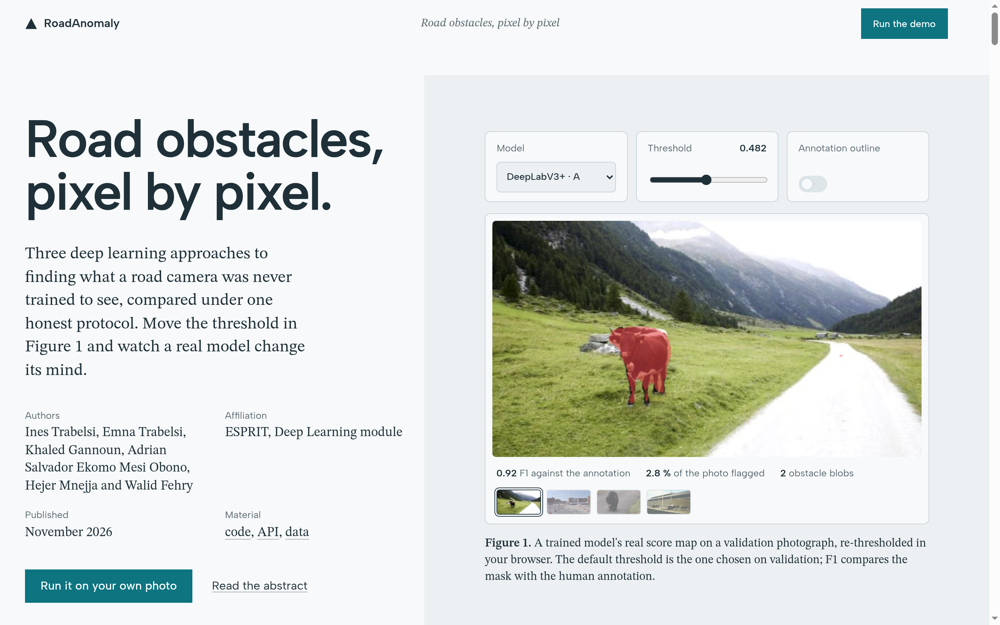
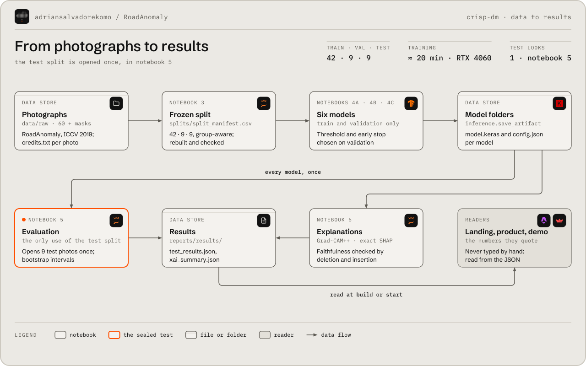
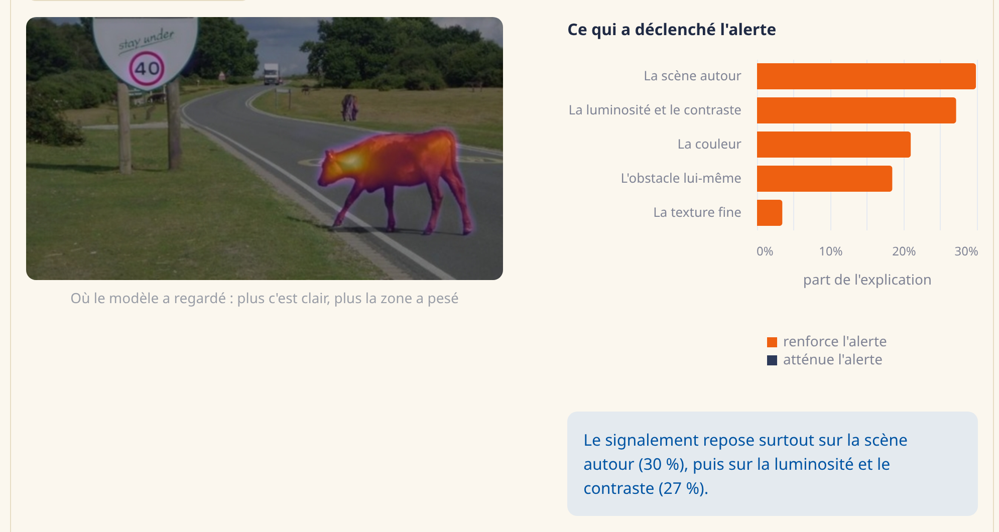
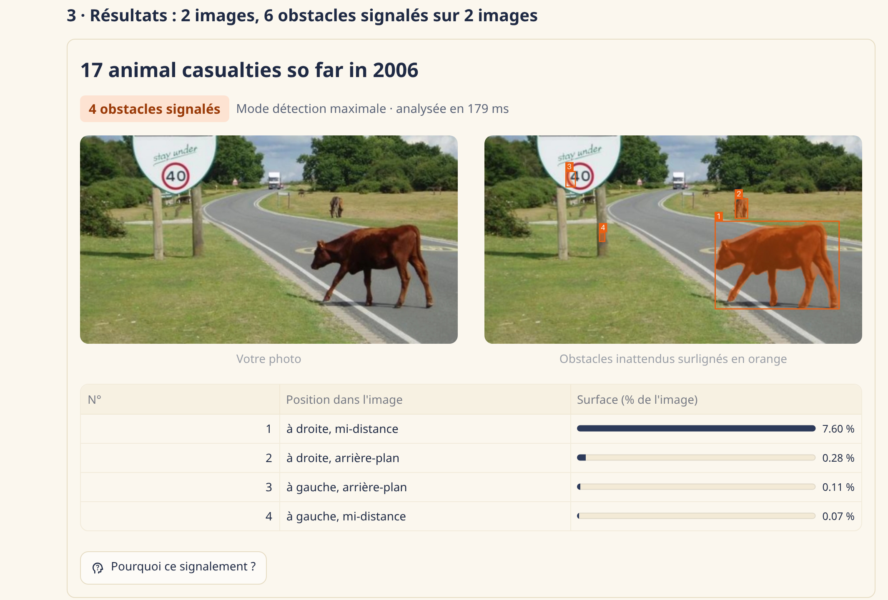

<h1 align="center">RoadAnomaly</h1>

<p align="center">
  Pixel-level detection of <b>unexpected obstacles on the road</b> (animals, rocks, cones, lost loads) without a closed list of objects.<br>
  Six models from three approaches, compared under one protocol, judged once on a sealed test split, each warning explained twice,<br>
  and served through an API, a customer-facing product, a technical demo and a static landing page.
</p>

<p align="center">
  <a href="https://roadanomaly-landing.vercel.app"></a>
  
  
  
  
  
  
  <a href="https://hub.docker.com/u/twelvy1400"></a>
</p>

<p align="center">
  
  <br><sub>The <a href="https://roadanomaly-landing.vercel.app">landing page</a>: a trained model's real score map, re-thresholded in the browser.</sub>
</p>

---

ESPRIT · Deep Learning module · Group of 6 · Final submission: 8 November 2026

**Authors:** Ines Trabelsi, Emna Trabelsi, Khaled Gannoun, Adrian Salvador Ekomo Mesi Obono, Hejer Mnejja, Walid Fehry

| Binôme | Members | Approach | Notebook |
|---|---|---|---|
| A | Ines Trabelsi · Emna Trabelsi | DeepLabV3+ with transfer learning (frozen ImageNet ResNet50) | [`4_Modeling/A_DeepLabV3Plus.ipynb`](notebooks/4_Modeling/A_DeepLabV3Plus.ipynb) |
| B | Khaled Gannoun · Adrian Salvador Ekomo Mesi Obono | Convolutional autoencoders: pixel AE (baseline) and feature-space AE on frozen VGG16 (final) | [`4_Modeling/B_Autoencoder.ipynb`](notebooks/4_Modeling/B_Autoencoder.ipynb) |
| C | Hejer Mnejja · Walid Fehry | CNN baseline (Hejer), U-Net from scratch and U-Net with ImageNet ResNet50 encoder (Walid) | [`4_Modeling/C_CNN_UNet.ipynb`](notebooks/4_Modeling/C_CNN_UNet.ipynb) |

## What it is for

A car's camera network knows a closed list of things: road, car, person, sign. Put a cow on the road and it still has to answer with one of its words, so it may call the cow "road". RoadAnomaly says instead *"these pixels are something I did not expect"*: a mask that shows a driver-assistance system **where** the obstacle is and **how big** it is, without knowing **what** it is.

- **One protocol for every model.** Every model trains on the same 42 photographs, is chosen on the same 9 and is judged **once** on the same 9 sealed test photographs (22 obstacles). Thresholds and early stopping use validation only.
- **One model format, one inference path.** Training ends with `inference.save_artifact`, which writes one folder per model. The `Predictor` reads any of them, so notebook 5, the API, both apps and the video script produce the same masks.
- **Every warning is explained twice.** Grad-CAM++ shows *where* the score comes from; exact SHAP over five image factors shows *what* raised it.
- **The numbers are never typed by hand.** The landing page, the product and the demo read them from `reports/results/*.json`.

## How it works

<picture>
  <source media="(prefers-color-scheme: dark)" srcset="docs/diagrams/c4/c4-container-dark.svg">
  
</picture>
<p align="center"><sub>C4 level 2 · <a href="docs/diagrams/c4/c4-context-light.svg">level 1: context</a> · <a href="docs/diagrams/c4/c4-component-light.svg">level 3: the inference path</a></sub></p>

- **Each front end loads the models itself.** The API, the product and the demo import `deployment/service.py` and keep each model in memory after one warm-up call. The product calls the API only for its health on the Integration page, so no front end depends on another to answer.
- **Models live outside the images.** `models/` is mounted read-only; the images carry the code, the frozen split, the photographs and the results. The ImageNet VGG16 backbone that the feature autoencoder loads is downloaded at build time and baked in.
- **CPU in containers, GPU in notebooks.** The images use `tensorflow-cpu` 2.20 for portability; training ran on an RTX 4060 laptop GPU with the same pinned TensorFlow.

<picture>
  <source media="(prefers-color-scheme: dark)" srcset="docs/diagrams/c4/c4-pipeline-dark.svg">
  
</picture>

## Results

Nine test photographs, 22 obstacles, evaluated once with thresholds fixed on validation (`reports/results/`, notebook 5). F1 is the per-image mean with its 95 % bootstrap interval; chance AuPRC is 0.086.

| Binôme | Model | AuPRC | F1 = Dice [95 % CI] | Obstacles found | False alarms / blobs | ms / photo (RTX 4060) | Business criteria |
|---|---|---|---|---|---|---|---|
| A | DeepLabV3+ (frozen ResNet50) | **0.755** | **0.739** [0.62, 0.84] | 20/22 | 38/67 | 21 | 3 / 4 |
| C | U-Net with ImageNet ResNet50 | 0.687 | 0.708 [0.59, 0.81] | 16/22 | 64/93 | 48 | 3 / 4 |
| B | Feature-space autoencoder (VGG16) | 0.631 | 0.623 [0.51, 0.73] | 16/22 | **10/22** | 40 | **4 / 4** |
| C | U-Net from scratch | 0.378 | 0.447 [0.35, 0.54] | 10/22 | 80/117 | 16 | 2 / 4 |
| C | CNN baseline | 0.353 | 0.340 [0.23, 0.44] | 9/22 | 155/219 | 13 | 2 / 4 |
| B | Pixel autoencoder (baseline) | 0.178 | 0.248 [0.12, 0.39] | 16/22 | 40/45 | 26 | 2 / 4 |

The top three are not separated by the paired bootstrap (for example DeepLabV3+ − U-Net ResNet50 = +0.030 [−0.010, 0.081]); each of them is established as better than the bottom three. Only the feature autoencoder meets all four business criteria (`notebooks/1_Business_Understanding.md`, section 4). Earlier looks at the test set are disclosed in notebook 5.

**Recommendation.** DeepLabV3+ by default (the API and the video script use it); the feature autoencoder where a false alarm is expensive.

## Explanations

Every model is explained by two methods, always together and on the same target: its score on the region it flagged (mean anomaly logit for the segmentation models, mean reconstruction error for the autoencoders).

- **Where — Grad-CAM++** (Grad-CAM available): which part of the image that score comes from. It is the default because it is the more faithful map under the deletion / insertion test: it beats random orders for 5 of the 6 models, and fixes the feature autoencoder, where plain Grad-CAM does worse than random (deletion area 65.5 vs 31.3 → 29.9). Neither method passes for the U-Net from scratch.
- **What — exact SHAP over five image factors**: colour, fine texture, brightness and contrast, the obstacle itself, the surrounding scene. Each factor has a stated removal transform (`xai.FACTOR_REMOVAL`); the score is recomputed for all 2⁵ = 32 combinations, so the Shapley values are exact and add up to the score change (largest gap over 54 explanations below 1e-13, float rounding).

| Model | Colour | Fine texture | Brightness & contrast | The obstacle | The scene |
|---|---|---|---|---|---|
| DeepLabV3+ | 14 % | 5 % | 30 % | 20 % | **31 %** |
| Feature autoencoder | 12 % | 24 % | **37 %** | 22 % | 6 % |
| Pixel autoencoder | 7 % | 20 % | 34 % | **38 %** | 0 % |
| CNN baseline | 18 % | 2 % | **63 %** | 17 % | 1 % |
| U-Net | 19 % | 5 % | **54 %** | 17 % | 5 % |
| U-Net ResNet50 | 15 % | 14 % | **39 %** | 22 % | 11 % |

Mean share of each model's Shapley attribution over the nine validation photographs (`reports/results/xai_summary.json`). Explanations describe the models; none of them was used to choose a model or a threshold.

<p align="center">
  
  <br><sub>The same paired explanation in the product, on a validation photograph.</sub>
</p>

## The product

The customer MVP follows the team's marketing deck, in French. It offers two modes (*Détection maximale* = DeepLabV3+, *Peu de fausses alarmes* = the feature autoencoder), each quoting its own test numbers. Uploads are checked, results are located in the image, and the report exports to CSV or HTML. Plans and quotas are simulated: there is no account and no payment. Full description: [docs/DEPLOYMENT.md](docs/DEPLOYMENT.md).

<p align="center">
  
  <br><sub>Maximum-detection mode on a real photograph: both animals found, plus two small false alarms, the trade-off the results table describes.</sub>
</p>

## Quick start

The trained models are not in git (`models/` is git-ignored): run `mise run train` (about 20 minutes on an RTX 4060) or copy the `models/` folder from a teammate.

```bash
docker compose -f deployment/docker-compose.yml pull     # twelvy1400/roadanomaly, twelvy1400/roadanomaly-landing
docker compose -f deployment/docker-compose.yml up -d    # add --build to build from source
```

| | URL |
|---|---|
| API (interactive docs) | http://localhost:8000/docs |
| Technical demo | http://localhost:8501 |
| Product (French) | http://localhost:8502 |
| Landing page | http://localhost:4321 · live at [roadanomaly-landing.vercel.app](https://roadanomaly-landing.vercel.app) |

```bash
curl -F "file=@data/raw/RoadAnomaly/frames/animals14_Dekemhare_Road.webp" localhost:8000/predict
```

Without Docker: `mise run setup`, then `mise run api`, `mise run app`, `mise run product` or `mise run landing`. `mise run help` lists every task. Installing, training on other hardware, GPU notes and VS Code: [docs/SETUP.md](docs/SETUP.md).

## Testing

```bash
mise run test     # 75 tests: metrics, split, inference contract, XAI, API, product
mise run check    # quality gate: no absolute paths, master notebook up to date, ruff clean
```

`mise run test` also checks that each saved model reproduces its validation AuPRC. On this branch the suite passes (75 tests, CPU) and `ruff check .` is clean.

## Repository map

```text
notebooks/          CRISP-DM phases 1–6, one modeling notebook per pair, a generated master notebook
src/roadanomaly/    shared code: split, loader, metrics, post-processing, inference (Predictor), XAI, models
deployment/         service.py (shared by API and apps) · api/ (FastAPI) · app/ (demo) · product/ · landing/ (Astro) · Docker
scripts/            evaluate.py · infer_video.py · build_master_notebook.py · gpu_memory_check.py
reports/results/    test_results.json, xai_summary.json (tracked; every published number comes from here)
splits/             split_manifest.csv: the frozen 42 / 9 / 9 split
docs/               SETUP.md · PROTOCOL.md (layout, rules, shared protocol) · DEPLOYMENT.md · diagrams/c4/
```

## Limitations

- **The test split is small.** It has 9 photographs, so one photograph moves a mean by about 11%, and the top three models cannot be separated.
- **No small obstacle in the test split**, so small-object performance is not measured on test.
- **Not an out-of-distribution benchmark.** RoadAnomaly serves for both training and testing here.
- **Latency was measured on one GPU** (RTX 4060 laptop). The containers run on CPU and are slower: about 180 ms per photograph for DeepLabV3+ in the product.
- **The product's plans are simulated.** There are no accounts and no payments.
- **The models are not published in the images.** They have to be trained or copied before the API answers.

## Dataset and licences

RoadAnomaly by K. Lis, K. Nakka, P. Fua and M. Salzmann, *Detecting the Unexpected via Image Resynthesis*, ICCV 2019. The images belong to their authors and are provided for research purposes; sources and licences are in [`data/raw/RoadAnomaly/credits.txt`](data/raw/RoadAnomaly/credits.txt). The annotations are CC BY-SA 4.0.

More: [project layout, rules and protocol](docs/PROTOCOL.md) · [architecture drawings for slides](docs/architecture/README.md)
