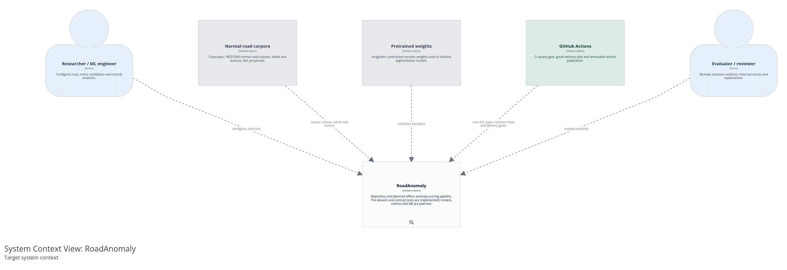
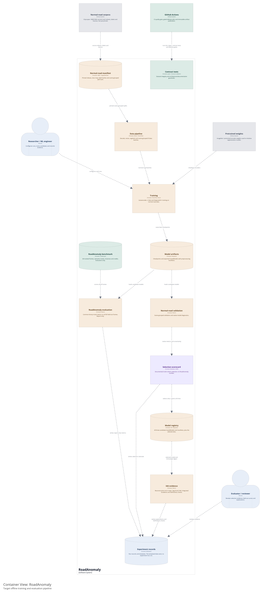

<div align="center">

# RoadAnomaly — Pixel-Level Road Anomaly Detection

*Deep Learning module project · TensorFlow/Keras · autoencoder · U-Net · DeepLabV3+*

**Finding the unexpected on the road: animals, cones, boulders, debris and other
objects that a driving perception stack was never trained to expect.**

[](https://github.com/adriansalvadorekomo/RoadAnomaly/actions/workflows/ci.yml)
[](https://github.com/adriansalvadorekomo/RoadAnomaly/actions/workflows/cd.yml)
[](LICENSE)
[](data/credits.txt)
[](pyproject.toml)
[](docs/adr/0005-tensorflow-framework.md)

</div>

> **How to read the status words.** `implemented` means a file or command in
> this repository proves the capability. `in progress` means partial evidence
> exists. `missing` means no artefact exists. `blocked` means a named dependency
> must land first. The authority is
> [`docs/validation/requirements-matrix.md`](docs/validation/requirements-matrix.md);
> a sentence in this README is never evidence for its own claim.
>
> **Snapshot 2026-10-21.** The 60-frame benchmark, its contract tests and the
> documentation guardrails exist. No model, training run, metric implementation,
> XAI artefact, API, frontend or deployment exists. The architecture diagrams
> are target-state, not a running system.

## 1. What this project is

A segmentation model trained on Cityscapes or BDD100K predicts a closed set of
classes: road, car, pedestrian, sky. Anything else — a deer on the asphalt, a
ladder that fell off a truck, a boulder around a bend — is either absorbed into
the nearest known class or ignored. At 50 km/h, "ignored" is an incident.

Road anomaly detection reframes this as **per-pixel out-of-distribution
detection**: produce a score map where high values mean *this pixel does not
belong to anything the model was trained to recognise*. The model is never given
an "anomaly" class to learn. It is trained on normal driving scenes and has to
notice when the world stops matching them.

| # | Objective | What would prove it | Status |
|---|---|---|---|
| O1 | Understand the benchmark and freeze an honest protocol | Dataset section, ADR-0001 and dataset contract tests | `in progress` — facts verified; EDA notebook missing |
| O2 | Implement three models behind one score-map interface | Autoencoder, U-Net and DeepLabV3+, trained reproducibly | `missing` |
| O3 | Compare them with one metric contract | Results populated from `docs/experiments/` | `missing` |
| O4 | Explain the selected model | Per-frame XAI artefacts, faithfulness checks and a written justification | `in progress` — methods selected; no code or artefacts |
| O5 | Serve the selected model | FastAPI, Streamlit prototype, Astro page, containers and deployment | `missing` |
| O6 | Make the commercial case | BMC, 4Ps, teaser and commercial report | `missing` |

## 2. Current state

| Component | State | Evidence |
|---|---|---|
| RoadAnomaly dataset | `implemented` | `data/`, 60 frames and labels tracked in git |
| Dataset contract tests | `implemented` | 6 tests in `tests/dataset/` |
| Architecture contract tests | `implemented` | `tests/architecture/`, C4 DSL and committed PNG checks |
| Lint, types and test gate | `implemented` | `ruff`, `mypy`, `pytest`; `.github/workflows/ci.yml` |
| Decision records and protocol | `implemented` | `docs/adr/0001`–`0012` |
| Scaffold, Makefile and templates | `implemented` | `Makefile`, `.github/`, `docs/experiments/0000-template.md` |
| Models, training, metrics and inference | `missing` | `dl/` holds directories only |
| XAI | `in progress` | methods and evidence contract in `docs/xai.md`; no implementation |
| Backend, frontend and containers | `missing` | package stub and READMEs only |
| Deployment (compose, Kubernetes, Vercel) | `missing` | target in ADR-0004; no manifests |

The only executable pipeline today is CI plus the dataset and architecture tests.
That is deliberate: the evaluation protocol, data contract, metric contract and
promotion rule were frozen before model code existed.

## 3. Architecture

The C4 model is defined once in
[`docs/architecture/workspace.dsl`](docs/architecture/workspace.dsl) and rendered
to the PNGs below. The diagrams are **target-state**. Implemented elements are
green in the source model's status tags; planned elements are amber and external
planned systems are grey. Online inference and deployment views are deliberately
absent until those files exist.

### C1 — system context

<a href="docs/architecture/diagrams/c1-system-context.png"></a>

### C2 — offline pipeline

<a href="docs/architecture/diagrams/c2-offline-pipeline.png"></a>

**This is the target, not the current state.** The project follows the six
[CRISP-DM](https://www.ibm.com/docs/en/spss-modeler/saas?topic=dm-crisp-help-methodology)
phases in [ADR-0007](docs/adr/0007-crisp-dm-methodology.md). They are iterative
and evidence-gated, not a waterfall.

| Phase | What it owns here | Status |
|---|---|---|
| **1. Business understanding** | Scope, model lineup, success criteria and evaluation-only protocol | `in progress` — ADR-0001, ADR-0007, ADR-0010 |
| **2. Data understanding** | RoadAnomaly facts and EDA; normal-road release, licence and scene audit | `in progress` — dataset tested; EDA and normal-road manifest missing |
| **3. Data preparation** | `tf.data` loading, augmentation, scene-grouped folds and pinned manifest | `missing` — no loader or run config |
| **4. Modeling** | Autoencoder, U-Net and DeepLabV3+ training | `missing` — [ADR-0010](docs/adr/0010-model-lineup-and-evaluation-contract.md) |
| **5. Evaluation** | Metrics, normal-road selection, held-out RoadAnomaly scoring and XAI | `missing` — contracts only; see ADR-0011 |
| **6. Deployment** | Registry, FastAPI, Streamlit, Astro, containers and GitOps | `missing` — target in ADR-0004 and ADR-0006 |

Four rules make the diagram reviewable:

- **RoadAnomaly is scoring only.** Selection, early stopping and thresholds come
  from scene-grouped folds of the normal-road corpus. There is deliberately no
  edge from RoadAnomaly evaluation or XAI to the registry.
- **The registry keeps all three candidates.** Normal-road selection writes a
  `selected` alias, but the three SavedModels and manifests stay for audit.
  See [ADR-0008](docs/adr/0008-promotion-and-model-registry.md).
- **XAI is a gate, not decoration.** It sits in Evaluation, consumes the selected
  model and writes to the experiment record. It never promotes a model. See
  [ADR-0009](docs/adr/0009-xai-evaluation-gate.md) and
  [ADR-0011](docs/adr/0011-xai-methods-and-faithfulness.md).
- **Delivery is pull-based.** Gated CI/CD publishes immutable image digests and
  an OCI model bundle to GHCR. A reviewed commit pins them; Argo CD pulls and
  syncs Minikube. CI does not hold cluster credentials. None of that exists yet.

Render and verify:

```bash
./docs/architecture/render.sh
.venv/bin/pytest -q tests/architecture -v
```

[`docs/architecture/README.md`](docs/architecture/README.md) explains the C4
model, the renderer pin and the CRISP-DM mapping. Architecture decisions that are
expensive to reverse go to [`docs/adr/`](docs/adr/).

## 4. Dataset and evaluation protocol

`data/` is tracked in this repository (15 MB) so a clone is reproducible. Core
facts are asserted by
[`tests/dataset/test_dataset_integrity.py`](tests/dataset/test_dataset_integrity.py):
if the dataset changes, CI fails instead of letting the documentation drift.

| Property | Value |
|---|---|
| Images | **60** frames, `data/frames/*.webp`, all **1280 × 720**, RGB |
| Index | `data/frame_list.json` — frame order used by every loader |
| Annotation dirs | **60** — one `<frame>.labels/` per frame |
| Semantic masks | `labels_semantic.png`, uint8, **{0 = normal, 2 = anomaly}** in all 60 |
| Colour masks | `labels_semantic_color.png` — black = normal, orange `#FF4500` = anomaly |
| Instance masks | `labels_instance.png` in **46** frames; pixel value = instance id |
| Instances | **201** bounding regions, **all `cls = 2`** (one anomaly class) |
| Semantic-only frames | **14** — annotated but with no instance masks |
| Anomaly coverage | **9.8 %** of all pixels; per frame: **0.4 % → 42.3 %** (median 6.6 %) |
| Object scale | median instance ≈ **87 × 87 px**; **35 of 201** are smaller than 32 × 32 px |
| Categories | animals 31 · obstacles 15 · cones 8 · lost_tires 3 · vehicle 3 |
| Attribution | [`data/credits.txt`](data/credits.txt) — per-image author, source and licence |

**Category distribution** (by frame-name prefix, the natural scene grouping):

```
animals     31  ███████████████████████████████
obstacles   15  ███████████████
cones        8  ████████
lost_tires   3  ███
vehicle      3  ███
```

Inside a label directory, the loader uses `labels_semantic.png`,
`labels_semantic_color.png`, `labels_instance.png` and `index.json`. The
GrabCut editor state (`instance_XXX_gc_mask.png` and
`instance_XXX_gc_state.npy`) is kept for provenance only and is never read.
`data/readme.md` is the original authors' format description and the authority
if this table and that file disagree.

### Why the benchmark is hard

- **Long tail of scale.** 17 % of instances are under 32 × 32 px, while in some
  frames the anomaly covers more than 40 % of the image. One operating threshold
  cannot serve both, so results report per-frame distributions, not just means.
- **Uneven coverage.** Six frames contain under 1 % anomalous pixels. A model
  that predicts "all normal" scores well on those and poorly overall; a single
  aggregate hides the failure that matters.
- **Single class, no hierarchy.** `cls = 2` for every instance means the project
  can measure localisation but not recognition. It does not claim to know a deer
  from a cone.

### The constraint that shapes everything

> **RoadAnomaly is an evaluation-only benchmark. We never fit weights on its 60
> frames.**

Every mask contains normal pixels and an anomaly; there is no image without
something abnormal. The usual "random split, train, report test metrics" recipe
is unavailable: any model trained here would be tested on its own training set.

The protocol in [**ADR-0001**](docs/adr/0001-evaluation-only-benchmark.md):

1. **Train on normal** — Cityscapes/BDD100K normal subsets with a pinned release
   and scene-grouped split manifest, plus ImageNet-pretrained backbones. The
   anomaly is defined by absence, never shown as a class.
2. **Report all 60 frames** — including the ones we fail on, with per-frame
   distributions published, not just the mean.
3. **Split only for tuning** — scene-grouped folds by benchmark scene prefix
   (`animals*`, `cones*`, `obstacles*`) for the separately reported
   *threshold-tuned* regime. These folds never select weights, checkpoints or the
   registry alias; early stopping uses normal-road folds whose release and split
   hash are pinned in the run manifest.
4. **Two regimes, labelled honestly** — *zero-shot* (nothing tuned on
   RoadAnomaly) and *threshold-tuned* (one scalar chosen on held-out benchmark
   folds). They never share a column and never pick the model.

### Licensing — read before publishing figures

The code is MIT. The data is not: images are third-party photographs provided
for research use with per-image terms ([`data/credits.txt`](data/credits.txt)),
and the annotations are **CC BY-SA 4.0**. Republishing frames in a paper, figure
or slide deck requires that attribution to travel with them. See
[`LICENSE`](LICENSE) for the full carve-out.

## 5. Models, metrics and XAI

**Status: `missing`.** The model lineup and evaluation contract are in
[**ADR-0010**](docs/adr/0010-model-lineup-and-evaluation-contract.md). The three
models share one score-map interface, so comparison is a config change rather
than three separate projects.

| Model ID | Architecture | Anomaly score | Why this model |
|---|---|---|---|
| `autoencoder` | Convolutional autoencoder | Per-pixel reconstruction error | Needs no anomaly labels; establishes a reconstruction baseline and an instructive failure mode |
| `unet` | U-Net | `1 - max softmax` (MSP) | Strong CNN segmentation baseline with skip connections for small objects |
| `deeplabv3plus` | DeepLabV3+ | `1 - max softmax` (MSP) | Transfer-learned multi-scale segmentation with an ASPP encoder and decoder |

- U-Net and DeepLabV3+ train on the same normal-road semantic labels and class
  map. Their anomaly score is the same MSP function, so the comparison changes
  the architecture rather than the scoring rule.
- No model trains on RoadAnomaly. No train/validation/test split of the 60
  benchmark frames exists. A binary anomaly mask is produced only when a score
  map is thresholded for evaluation.
- Image resynthesis is retired from the three-model comparison. The Lis et al.
  paper remains the dataset reference and related work.

The planned interface is one score map per frame:

```python
model = build(config)            # Keras model; no benchmark data
scores = model.predict(batch)    # per-pixel anomaly score map in [0, 1]
model.export(saved_model_dir)    # SavedModel plus preprocessing manifest
```

The API will load the exported SavedModel with `tf.saved_model.load`; there is
no TorchScript or ONNX step (ADR-0005). The interface is a contract, not an
implemented module.

### Metrics

The normative contract is [`docs/metrics.md`](docs/metrics.md). In summary:

| Family | Common binary-mask metrics | Complementary diagnostics |
|---|---|---|
| All three models | Precision, recall, F1, IoU, Dice | — |
| `autoencoder` | same | AUROC, AUPRO (report the FPR cap) |
| `unet` | same | HD95 (pixels; state spacing and empty-mask policy) |
| `deeplabv3plus` | same | mIoU (per class) and Boundary IoU (band width) |

- **F1 equals Dice** for a binary mask. Reports must say so, not present them as
  independent evidence.
- Thresholds are fixed on normal-road validation. A separately reported
  threshold-tuned scalar may be chosen on scene-grouped benchmark folds under
  ADR-0001, but never promotes a model.
- Metrics are implemented once in `dl/evaluation/metrics.py`; that file does not
  exist yet. The metric definitions are a planned contract, not a result.

### XAI

XAI is an Evaluation gate, not a UI afterthought and not a fourth model.
[ADR-0011](docs/adr/0011-xai-methods-and-faithfulness.md) fixes the methods:

| Model | Primary explanation | Secondary explanation |
|---|---|---|
| `autoencoder` | Per-pixel reconstruction-error map (a model output, not an explanation) | Integrated Gradients on the scalar mean reconstruction error |
| `unet` | Seg-Grad-CAM on decoder feature maps | Integrated Gradients for a target pixel/class |
| `deeplabv3plus` | Seg-Grad-CAM per ASPP branch and decoder stage | Integrated Gradients for a target pixel/class |

Deletion/insertion curves are compared with random-order and center-prior
baselines; segmentation methods also report a pointing game against a random-hit
baseline. Heatmaps and error maps are correlational, not causal. XAI never
changes weights, thresholds, the selected alias or the registry. No XAI code or
artefact exists; the method decision is resolved and V1.8 remains `in progress`.
The full evidence contract is [`docs/xai.md`](docs/xai.md).

### Results (not published)

No model has been trained, so no number is published. The table stays empty until
an experiment record in `docs/experiments/` traces every value to a commit,
config, normal-road manifest, split hash, command and hardware. Normal-road
selection and RoadAnomaly held-out scores are separate columns on purpose.

| Model | Native normal-road validation (selection) | RoadAnomaly zero-shot | RoadAnomaly threshold-tuned |
|---|---|---|---|
| `autoencoder` | — | — | — |
| `unet` | — | — | — |
| `deeplabv3plus` | — | — | — |

Any illustrative calculations from planning documents are not project results
and must never be copied into this table.

## 6. Development workflow

```bash
git clone https://github.com/adriansalvadorekomo/RoadAnomaly.git
cd RoadAnomaly

make install              # venv + dev, deep learning, API and prototype dependencies
make data-check           # verify the dataset contract (fast, no GPU)
make architecture         # render C1/C2 and refresh diagrams/manifest.json
make lint type test       # what CI runs
pytest -q tests/architecture -v
```

| Target | Purpose | Status |
|---|---|---|
| `make install` | Create `.venv` and install local dev, training, API and prototype dependencies | `implemented` |
| `make data-check` | Six dataset integrity tests | `implemented` |
| `make architecture` | Render the C4 PNGs and manifest from `workspace.dsl` | `implemented` |
| `make lint` / `make fmt` | Ruff lint and format | `implemented` |
| `make type` | Mypy over `dl`, `backend` and `tests` | `implemented` |
| `make test` | Full pytest suite | `implemented` |
| `make train CONFIG=configs/autoencoder.yaml` | Training loop | `missing` — `dl/training/train.py` |
| `make eval CKPT=artifacts/best.keras` | Shared evaluation | `missing` — `dl/evaluation/evaluate.py` |
| `make export CKPT=artifacts/best.keras` | SavedModel export | `missing` — `dl/inference/export_savedmodel.py` |
| `make serve` | FastAPI on `:8000` | `missing` — `backend/app/main.py` |
| `make landing` | Astro landing page on `:4321` | `missing` — `frontend/landing/package.json` |
| `make prototype` | Streamlit prototype on `:8501` | `missing` — `frontend/prototype/app.py` |
| `make up` / `make down` | Local compose stack | `missing` — `infra/compose/docker-compose.yml` |

The dataset is already in the repository; there is no download step.
**Requirements:** Python 3.12 (the version CI, training and serving pin), Java
21 + Chromium for the architecture renderer, and Node 20+ only for the Astro
landing page.
Training needs a GPU for reasonable throughput; every model runs CPU-only at
reduced speed. `requirements/dl.txt` documents the TensorFlow CPU package and
Apple Silicon note.

## 7. Testing and code quality

| Tier | Scope | Status |
|---|---|---|
| `tests/dataset/` | Frame ↔ label contract, mask vocabulary, instance consistency | `implemented` — 6 tests |
| `tests/architecture/` | C4 DSL, evaluation-only guardrail, selection/registry rule, XAI gate, rendered PNGs | `implemented` |
| `tests/unit/` | Pure functions: metrics, mask decoding, thresholding | `missing` — appears with the first model module |
| `tests/integration/` | API contract, artifact loading, end-to-end inference | `missing` — appears with the backend |

The dataset tests re-derive the documented facts — 60 frames, the `{0, 2}`
label vocabulary, 201 instances, 46 instance-annotated directories and 14
semantic-only ones — and fail the build if data and documentation disagree. The
architecture tests enforce the rules that are easy to lose in a diagram edit:
RoadAnomaly and XAI cannot reach the registry, selection comes from normal-road
validation, all three candidates remain, and the committed PNGs match the DSL
manifest.

`ruff check`, `ruff format --check` and `mypy` run over the whole repository
(Markdown excluded from formatting). CI runs the same commands; see
[`tests/README.md`](tests/README.md) for the tier contract and
[`CONTRIBUTING.md`](CONTRIBUTING.md) for the suppression rule.

## 8. Delivery target (not implemented)

There is no API, frontend, container, Kubernetes manifest, Argo CD application
or Vercel project. The target is recorded in
[ADR-0003](docs/adr/0003-monorepo-and-serving-stack.md),
[ADR-0004](docs/adr/0004-vercel-and-gitops-deployment.md) and
[ADR-0006](docs/adr/0006-astro-and-streamlit-frontend.md).

| Surface | Stack | Runs on | Purpose |
|---|---|---|---|
| Landing | Astro + Tailwind | Vercel | Story, published results, links to demo/report |
| Prototype | Streamlit | Minikube or compose | Pick a frame, choose a model, set threshold, inspect score map and overlay |
| API | FastAPI | ClusterIP | Load a SavedModel, score one image, return PNG payloads |

`POST /predict` is planned as `multipart/form-data` with `file`, `model` (one of
`autoencoder`, `unet`, `deeplabv3plus`) and an optional `threshold`. It returns
the model ID, immutable digest, echoed threshold, input size, base64 PNG score
map/mask/overlay, pixel statistics and timing. These are **pixel statistics, not
evaluation metrics**: an upload has no ground truth, so the API must not compute
IoU, Dice, AUROC or AUPRO. The prototype may re-threshold a cached score map but
must display the threshold used. The landing page makes no runtime API call.

Artifacts are never committed or baked into an image. The release bundle — three
candidate SavedModels, three manifests and `selected.json` — is a versioned OCI
artifact in GHCR; compose mounts a local `artifacts/` directory read-only. The
API fails at startup if the selected manifest is missing, rather than silently
serving a different model. Promotion pins immutable digests; `latest` and moving
`major.minor` tags are not deployment references.

## 9. Validation status

The module grades two independent validations. The full traceability matrix —
every requirement, evidence file and status — is
[`docs/validation/requirements-matrix.md`](docs/validation/requirements-matrix.md).
This table is only a summary; the matrix is authoritative.

| Validation | Weight | `implemented` | `in progress` | `missing` | `blocked` |
|---|---:|---:|---:|---:|---:|
| Technical (W9) | 60 % | 0 | 3 | 4 | 1 |
| Commercial (W10) | 40 % | 0 | 4 | 9 | 2 |
| **Both** | 100 % | **0** | **7** | **13** | **3** |

The zeros are the honest state at this commit. In particular:

- **XAI is gated, not planned away.** The method is selected and the evidence
  format is written, but no code or artefact exists. V1.8 is `in progress`, not
  `implemented`.
- **No model exists**, so the comparison, selected-model deployment and
  commercial demo are downstream of the same dependency.
- **No normal-road release, labels or split manifest is pinned**, so even the
  first training run cannot yet claim a reproducible train/validation boundary.
- **No separate image-level classifier exists.** U-Net and DeepLabV3+ provide
  dense multi-class prediction; the classification objective is met at pixel
  level, not by an image label. State this explicitly in the defence.
- **No complete commercial artefact exists** — a preliminary Business
  Understanding report is present, but there is no canvas, 4Ps, penetration
  strategy, logo/flyer, teaser or complete report.
- **Ownership is unassigned**; every CODEOWNERS path routes to the repository
  owner until the kickoff meeting.

## 10. Limitations and next work

**Scientific limitations.**

- **60 evaluation frames** mean every metric has a wide confidence interval.
  Results are reported as per-frame distributions; differences smaller than the
  spread are not argued about.
- **One anomaly class** means localisation is measurable but recognition is not.
- **No anomaly training data** by construction; the protocol is zero-shot or
  threshold-tuned on held-out folds, and the two regimes are never mixed.
- **Explanations are not proof.** Grad-CAM and Integrated Gradients are
  correlational, baseline-sensitive and coarse. They support inspection; they do
  not certify safety or correctness.

**Implementation gaps.** No normal-road manifest, loader, model, training loop,
metric harness, XAI implementation, experiment record, API, Astro page, Streamlit
prototype, container, Kubernetes manifest, Argo CD application or Vercel project
exists. The results table stays empty until a number can be traced to
`docs/experiments/`.

**Next work, in dependency order.**

1. Pin a normal-road release, semantic labels, class map and scene-grouped split
   manifest; record licences and hashes.
2. Implement the data pipeline and the autoencoder baseline behind the shared
   score-map interface.
3. Implement the metric contract once, then U-Net and DeepLabV3+.
4. Run normal-road selection, write the scorecard, and only then score all 60
   held-out frames.
5. Implement XAI and faithfulness checks on the selected model.
6. Add API, frontend, containers and GitOps only after an artifact exists.

**Commercial gaps.** A standalone preliminary Business Understanding report
covers the introduction and general context, but is not integrated into the
commercial report. The existing/deployed-solutions survey, Business Model
Canvas, 4Ps, penetration strategy, brand assets, teaser and complete report
remain outstanding. See [`docs/report/README.md`](docs/report/README.md).

**Risks, named.** *Compute:* three models on limited GPUs — mitigated by the
autoencoder being cheap and segmentation using pretrained backbones. *Scope:*
the experience layer comes after the deep learning work; if time slips, the
Astro page reduces to one static page and the Streamlit prototype carries the
demo. *Data:* the normal-road corpus must supply segmentation labels for U-Net
and DeepLabV3+; without them, the segmentation comparison is re-scoped before a
benchmark number is published. *Time:* three weeks for six people, with the
commercial validation landing after the technical one.

## Repository map

```
RoadAnomaly/
├── README.md               this file
├── AGENTS.md               instructions for coding agents
├── CONTRIBUTING.md         branching, review and suppression rules
├── Makefile                developer targets
├── pyproject.toml          ruff, mypy, pytest and coverage configuration
├── requirements/           dev · dl · api-base · api · prototype sets
├── data/                   60 frames + labels + credits        (implemented)
├── dl/
│   ├── data/               loader, mask decoding, splits        (missing)
│   ├── models/             autoencoder · U-Net · DeepLabV3+    (missing)
│   ├── training/           one loop for all three models        (missing)
│   ├── evaluation/         metrics.py — defined once            (missing)
│   ├── inference/          SavedModel export + scoring          (missing)
│   └── notebooks/          EDA and result narratives            (missing)
├── configs/                run YAML + dataset manifests          (README only)
├── backend/                FastAPI inference service            (missing — stub)
├── frontend/               Astro landing + Streamlit prototype  (missing — READMEs)
├── tests/
│   ├── dataset/            frame ↔ label contract (6 tests)     (implemented)
│   ├── architecture/       C4 DSL, guardrails and PNGs          (implemented)
│   ├── unit/               pure functions                       (missing)
│   └── integration/        API and artifact contracts           (missing)
├── infra/                  README; docker/ + compose/ planned   (missing)
├── docs/
│   ├── architecture/       workspace.dsl + rendered C4 PNGs/manifest
│   ├── adr/                0001–0012
│   ├── experiments/        one file per run set (template)      (empty log)
│   ├── report/             technical outline + commercial plan
│   └── validation/         requirements traceability matrix
└── .github/                CI/CD, CODEOWNERS, PR and issue templates
```

`k8s/` and `argocd/` do not exist. Creating them empty would imply a deployment
that is not there; they are documented as targets in §8 and ADR-0004. `assets/`
was removed with the old diagram tooling and should not return: publishable
figures live with the experiment record that produced them. Each existing
directory has its own README explaining what belongs in it.

## Reproducibility

No published number exists yet. When one does, it must be reproducible from:

```bash
# 1. the commit   2. the config in configs/   3. this command pair
make train CONFIG=configs/<name>.yaml
make eval  CKPT=artifacts/<name>.keras
```

- **Seeds must be fixed and recorded** in the config; data-loader worker seeding
  must be explicit, not inherited from the clock.
- **Notebook outputs are stripped before commit.** `.gitattributes` declares the
  `nbstripout` filter; each clone runs `nbstripout --install` once (see
  [`CONTRIBUTING.md`](CONTRIBUTING.md)).
- **Artefacts are not committed.** Checkpoints, SavedModel exports and run logs
  are regenerated; `artifacts/` is ignored.
- **The environment is pinned** by `requirements/*.txt` and the Python/Node
  versions in `.github/workflows/`. Each manifest records the TensorFlow version
  used for its artifact.
- **TensorFlow determinism:** when implemented, the training entrypoint must call
  `tf.keras.utils.set_random_seed(seed)` and
  `tf.config.experimental.enable_op_determinism()`. Where cuDNN or reduction
  kernels still shift metrics in the third decimal, the experiment file records
  the observed spread rather than pretending it is zero.
- **The architecture is reproducible** from `workspace.dsl` plus
  `docs/architecture/render.sh`; the manifest pins the DSL hash and renderer.

## Team

**Six contributors**, equal contribution — the list order is not a ranking.

| Contributor |
|---|
| Emna Trabelsi |
| Ines Trabelsi |
| Hejer Mnejja |
| Walid Fehry |
| Khaled Gannoun |
| Adrian Salvador Ekomo Mesi Obono |

The project is split into six workstreams so that each file belongs to one
workstream and no file has two. **Owners are assigned at the kickoff meeting** —
until then every path is reviewed by the repository owner (see
[`.github/CODEOWNERS`](.github/CODEOWNERS)).

| | Workstream | Scope | Also responsible for |
|---|---|---|---|
| **M1** | Data & protocol | `dl/data/`, `tests/`, splits | EDA notebook 01, keeping ADR-0001 true in code |
| **M2** | Model — autoencoder | `dl/models/autoencoder.py`, `dl/training/` | Reconstruction-error baseline and score-map interface |
| **M3** | Model — U-Net | `dl/models/unet.py` | Skip-connection baseline, HD95 analysis |
| **M4** | Model — DeepLabV3+ + metrics | `dl/models/deeplabv3plus.py`, `dl/evaluation/` | Shared metric harness and Boundary IoU/mIoU |
| **M5** | Backend & delivery | `backend/`, `infra/`, `.github/workflows/` | Compose stack, images, CI/CD |
| **M6** | Frontend & report | `frontend/`, `docs/`, architecture diagrams | Astro landing, Streamlit prototype, README, report assembly |

Everyone writes their own section of the report. **M4's metric harness is the
critical path**: it is the interface the other models plug into. Its contract is
frozen in [`docs/metrics.md`](docs/metrics.md); changes need M2, M3 and M4 to
agree.

## Citation

Cite the dataset paper as the authors request, in their own BibTeX key:

```bibtex
@inproceedings{DetectingTheUnexpected2019,
  title     = {Detecting the Unexpected via Image Resynthesis},
  author    = {Krzysztof Lis and Krishna Nakka and Pascal Fua and Mathieu Salzmann},
  booktitle = {International Conference on Computer Vision},
  year      = {2019},
  url       = {https://infoscience.epfl.ch/record/269093?ln=en}
}
```

The paper's image-resynthesis method is related work; it is not one of the three
project models. Also available as [arXiv:1904.07595](https://arxiv.org/abs/1904.07595).
Machine-readable metadata is in [`CITATION.cff`](CITATION.cff).

## License and credits

Code is [MIT](LICENSE). **The data is not.** Images are third-party photographs
provided for research purposes with per-image terms, and the annotations are
CC BY-SA 4.0. [`data/credits.txt`](data/credits.txt) lists the author, source and
licence of every frame — keep it intact in any redistribution, and carry the
attribution with any figure you publish.
