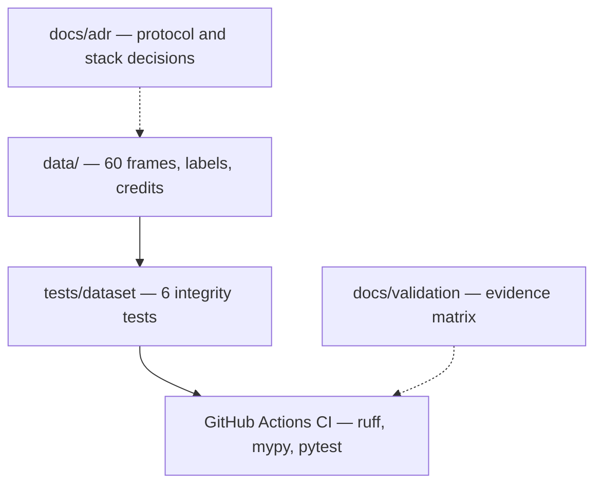
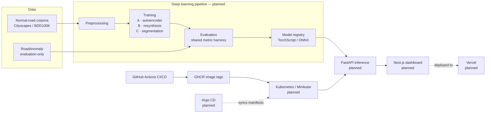
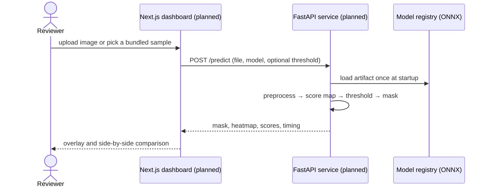
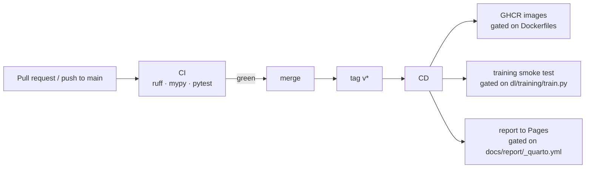
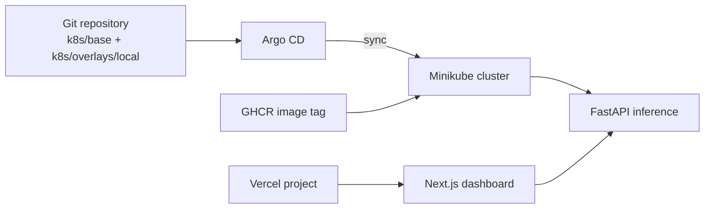

# Architecture

Component responsibilities, data flow and deployment boundaries for
RoadAnomaly. Every diagram is labelled **current** (exists in the repository
today) or **proposed** (target state, not implemented). The matrix in
[`docs/validation/requirements-matrix.md`](../validation/requirements-matrix.md)
is the authority on status.

| Term | Meaning here |
|---|---|
| **current** | Backed by files in this repository that run today |
| **proposed** | Agreed target; no implementation yet |
| **eval-only** | The 60 RoadAnomaly frames are never used to fit weights ([ADR-0001](../adr/0001-evaluation-only-benchmark.md)) |

The high-level picture is generated from
[`architecture.json`](architecture.json) with
[archify](https://github.com/tt-a1i/archify); open
[`architecture.html`](architecture.html) for the interactive version. The PNGs
embedded in the README are exported from the same spec.

## Current architecture (implemented)

The repository is a verified dataset, a test harness, a CI workflow and the
documentation that constrains the work. There is **no running model service**.

What runs today:

- `make data-check` re-derives every documented dataset fact.
- `make lint type test` is the same gate CI runs.
- `.github/workflows/ci.yml` runs on every pull request and every push to
  `main`.
- `.github/workflows/cd.yml` is valid but its image, smoke-test and report jobs
  are gated on files that do not exist yet.

## Target architecture (proposed)

The deep learning pipeline is described in
[ADR-0002](../adr/0002-three-model-families.md); the deployment target in
[ADR-0004](../adr/0004-vercel-and-gitops-deployment.md).

## Component responsibilities

| Component | Responsibility | Status |
|---|---|---|
| `data/` | The evaluation benchmark: 60 frames, semantic/instance labels, per-image credits | implemented |
| `tests/dataset/` | Guards the frame ↔ label contract and every number published in the README | implemented |
| `dl/data/` | Loading, mask decoding, transforms, scene-grouped folds | missing |
| `dl/models/` | Autoencoder, resynthesis and segmentation models behind one interface | missing |
| `dl/training/` | One training loop for all three families | missing |
| `dl/evaluation/` | The single implementation of every metric | missing |
| `dl/inference/` | Artifact export (TorchScript/ONNX) and shared scoring helpers | missing |
| `configs/` | One YAML per run, shared by training and evaluation | missing |
| `backend/` | FastAPI service, ONNX Runtime, `POST /predict` | missing |
| `frontend/` | Next.js dashboard: upload, overlay, heatmap, comparison | missing |
| `infra/docker/` | Backend and frontend images | missing |
| `infra/compose/` | Local two-service stack | missing |
| `k8s/`, `argocd/` | Local Kubernetes overlay and GitOps application | missing (documented target only) |
| `.github/workflows/` | CI on every PR; CD on tags | implemented, with gated jobs |

## Data flow

1. **Training** uses normal-road corpora only (Cityscapes/BDD100K normal
   subsets, ImageNet-pretrained backbones). The anomaly is defined by absence.
2. **Evaluation** runs every one of the 60 RoadAnomaly frames, including the
   failures. Each frame has at least 0.4 % anomalous pixels, so no frame is
   dropped from the per-frame statistics.
3. **Threshold tuning**, when reported, uses scene-grouped k-fold over the
   `animals*`, `cones*`, `obstacles*`, `lost_tires*` and `vehicle*` groups. It is
   never mixed with the zero-shot column.
4. **Serving** loads an exported artifact and returns a score map; the threshold
   is a request parameter, not a constant.

## Inference flow (proposed)

## Frontend/backend boundary

- `POST /predict` accepts `multipart/form-data`: `file`, `model`, optional
  `threshold`.
- The OpenAPI schema at `/docs` is the source of truth. Frontend types are
  generated from it; hand-written response shapes are not allowed.
- `GET /health` and `GET /models` are the only other endpoints.
- Nothing in this boundary exists yet: `backend/app/__init__.py` is the only
  backend file, and `frontend/` contains a README.

## CI/CD flow (implemented workflow, gated jobs)

The gates are computed by a small detection job; the optional jobs skip
cleanly until their files land.

## Local Kubernetes and GitOps flow (proposed)

No manifests, Argo CD application or Vercel project exist yet. The local
developer path remains `docker compose`; see
[`infra/README.md`](../../infra/README.md) and
[ADR-0004](../adr/0004-vercel-and-gitops-deployment.md).
