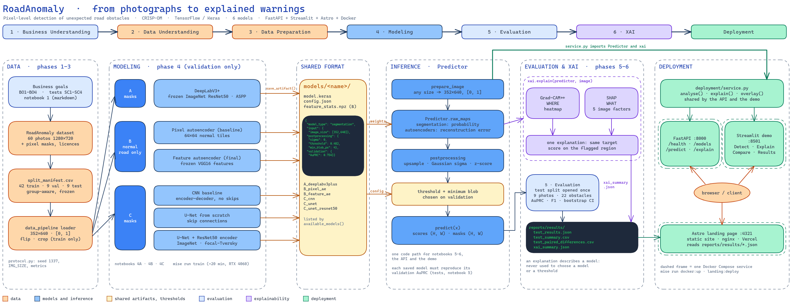

# Architecture drawings (Excalidraw and social-media versions)

Moved here from the README unchanged. The README now shows the C4 views in [`../diagrams/c4/`](../diagrams/c4/); these drawings stay for presentations and social posts.

*Click the image for the full size. Editable source: [`roadanomaly-architecture.excalidraw`](roadanomaly-architecture.excalidraw) (open it at [excalidraw.com](https://excalidraw.com), edit, then export a PNG over the one next to it).*

Two social-media versions of the architecture sit next to it: [`roadanomaly-stack.png`](roadanomaly-stack.png) (2160×2700, the stack with its technology icons, one container per CRISP-DM stage; generated by [`diagram_as_code.py`](diagram_as_code.py), which needs Playwright) and [`roadanomaly-linkedin.png`](roadanomaly-linkedin.png) (1080×1080 square, from [`roadanomaly-linkedin.html`](roadanomaly-linkedin.html)).

How to read it, left to right (the ribbon on top is the CRISP-DM phases; every box below is a file or module of this repository):
1. **Data.** The 60 RoadAnomaly photographs and masks go through the frozen, group-aware split (`splits/split_manifest.csv`) and the shared loader in `data_pipeline.py` (352×640, augmentation on the training images only).
2. **Modeling.** Three approaches, six models, all trained on the same loader and chosen on validation only: A DeepLabV3+; B pixel and feature autoencoders (trained on normal road only); C a CNN and two U-Nets.
3. **Shared format.** Training ends with `inference.save_artifact`, which writes one folder per model, `models/<name>/`, with `model.keras` and a `config.json` holding the input size, the post-processing settings and the threshold chosen on validation (the feature autoencoder adds `feature_stats.npz`).
4. **Inference.** One `Predictor` reads any of those folders: `prepare_image`, the model's raw score map, post-processing (upsample, Gaussian smoothing, per-image z-score), then the validation threshold and minimum blob size. The notebooks, the API and the demo all use this single code path.
5. **Evaluation and XAI.** Notebook 5 opens the test split once and writes `reports/results/`; notebook 6 explains every model with Grad-CAM++ (where) and exact SHAP over five image factors (what) and writes `xai_summary.json`.
6. **Deployment.** `deployment/service.py` imports the `Predictor` and `xai` and serves three front ends: the FastAPI service (`/health`, `/models`, `/predict`, `/explain`), the Streamlit technical demo (:8501) and the RoadAnomaly product, the customer MVP (:8502, `mise run product`). The Astro landing page is static and reads `reports/results/`. The four run as Docker Compose services (`mise run docker:up`); the landing page is also deployed to Vercel (`mise run landing:deploy`).

