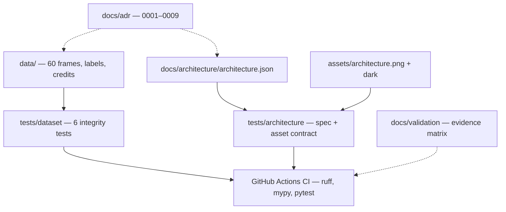
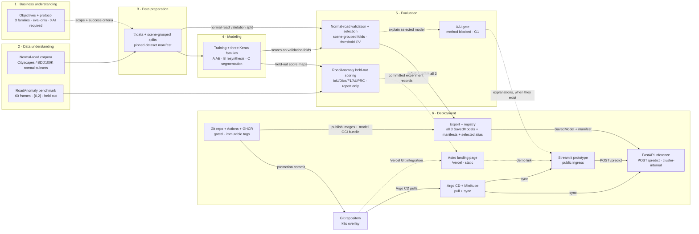
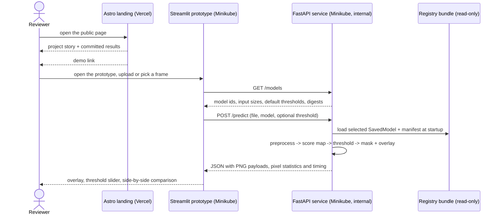
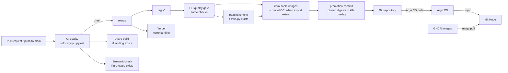
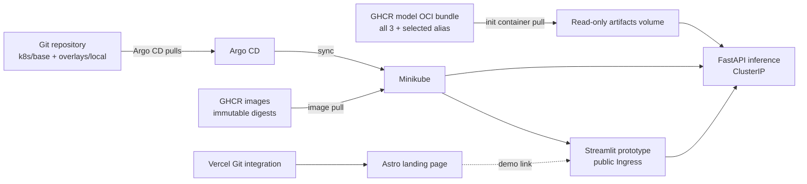

# Architecture

Component responsibilities, data flow and deployment boundaries for
RoadAnomaly. Every diagram is labelled **current** (exists in the repository
today) or **proposed** (target state, not implemented). The matrix in
[`docs/validation/requirements-matrix.md`](../validation/requirements-matrix.md)
is the authority on status.

| Term | Meaning here |
|---|---|
| **current** | Backed by files in this repository that run today |
| **proposed** | Agreed target; no implementation yet |
| **eval-only** | The 60 RoadAnomaly frames are never used to fit weights or thresholds ([ADR-0001](../adr/0001-evaluation-only-benchmark.md)) |
| **CRISP-DM** | The six-phase project methodology in [ADR-0007](../adr/0007-crisp-dm-methodology.md) |

The high-level picture is generated from
[`architecture.json`](architecture.json) with
[archify](https://github.com/tt-a1i/archify); open
[`architecture.html`](architecture.html) for the interactive version. The PNGs
embedded in the README are exported from the embed view at 2× (1860 × 1760 from
a 930 × 880 viewBox). The spec has **six CRISP-DM regions and thirteen
components**.

The interactive viewer scrolls on a 1440 × 900 laptop instead of shrinking the
labels below reading size. The README PNG is the primary artifact. The
architecture composition checks pass 9/9; the separate browser
`visual-check` reports vertical overflow because it measures the full viewer
page (header, cards and legend) against the viewport. That is a known trade-off,
not a claim that the viewer fits a laptop screen.

## Current architecture (implemented)

The repository is a verified dataset, a test harness, a CI workflow and the
documentation that constrains the work. There is **no running model service**.



What runs today:

- `make data-check` re-derives every documented dataset fact (6 tests).
- `tests/architecture/` checks the committed spec (unique IDs, six CRISP-DM
  regions, no benchmark-to-registry path, XAI present, PNG assets) without
  needing archify.
- `make lint type test` is the same gate CI runs.
- `.github/workflows/ci.yml` runs on every pull request and every push to
  `main`.
- `.github/workflows/cd.yml` is valid but its image, smoke-test, promotion and
  report jobs are gated on files that do not exist yet.

## Target architecture (proposed)

The map follows the six CRISP-DM phases in
[ADR-0007](../adr/0007-crisp-dm-methodology.md). The phases are iterative; the
arrows show the primary evidence path, not a waterfall.



There is deliberately **no edge from `RA` or `HELD` to `REG`**. RoadAnomaly
scores cannot promote a model. Selection is `VAL -> REG`; all three candidates
are retained for audit. The full promotion rule is in
[ADR-0008](../adr/0008-promotion-and-model-registry.md).

## CRISP-DM phase gates

| Phase | Gate before the next phase is credible | Evidence today |
|---|---|---|
| 1. Business understanding | Evaluation-only protocol accepted; objectives and success criteria written | `README.md` §1, ADR-0001, ADR-0007 |
| 2. Data understanding | Dataset facts re-derived; EDA notebook exists; normal-road sources and licences audited | 6 dataset tests; EDA missing (G2); normal-road manifest missing |
| 3. Data preparation | Dataset manifest pins source release, scene IDs and split hash; no benchmark sample enters training | `dl/data/` missing, `configs/` empty |
| 4. Modeling | All three families implement one Keras interface; training is seeded and reproducible | `dl/models/`, `dl/training/` missing |
| 5. Evaluation | Metrics frozen once; selection recorded from normal-road validation; held-out scores separated; XAI method decided and justified | `dl/evaluation/` missing; XAI blocked (G1) |
| 6. Deployment | Export manifest, all-three registry, immutable digests, health/smoke checks, GitOps promotion | Workflows exist; no images, manifests or deployment |

## Component responsibilities

| Component | Responsibility | Status |
|---|---|---|
| `data/` | The evaluation benchmark: 60 frames, semantic/instance labels, per-image credits | implemented |
| `tests/dataset/` | Guards the frame ↔ label contract and every number published in the README | implemented |
| `tests/architecture/` | Guards the spec, CRISP-DM regions, promotion rule, XAI presence and PNG assets | implemented |
| `dl/data/` | Normal-road loading, mask decoding, transforms, scene-grouped folds, dataset manifest | missing |
| `dl/models/` | Autoencoder, resynthesis and segmentation models behind one interface | missing |
| `dl/training/` | One TensorFlow/Keras training loop for all three families | missing |
| `dl/evaluation/` | The single implementation of every metric; threshold regimes; selection record | missing |
| `dl/inference/` | SavedModel export, serving signature and manifest generation | missing |
| `dl/notebooks/` | EDA and result narratives, including the benchmark audit | missing |
| `configs/` | One YAML per run; dataset manifests and split hashes; no code | missing |
| `backend/` | FastAPI service, `tensorflow-cpu`, `POST /predict` | missing |
| `frontend/landing/` | Astro + Tailwind static landing page on Vercel | missing |
| `frontend/prototype/` | Streamlit interactive client for FastAPI | missing |
| `infra/docker/` | API and prototype images; no weights baked in | missing |
| `infra/compose/` | Local two-service stack with a read-only `artifacts/` mount | missing |
| `k8s/`, `argocd/` | Local overlay, model-bundle mount and GitOps application | missing (documented target only) |
| `.github/workflows/` | CI on every PR; gated CD on tags; immutable digests; promotion commit | implemented, with gated jobs |
| `docs/experiments/` | One provenance record per run set; the only source for published numbers | template added; log empty |

## Data flow

1. **Business understanding** fixes the scope: three families, an evaluation-only
   benchmark and XAI as required evidence. RoadAnomaly is not a training source.
2. **Data understanding** audits the normal-road corpus and the benchmark. The
   benchmark facts are tested; the normal-road release and scene list are not
   pinned yet (G2).
3. **Data preparation** builds the `tf.data` pipeline and scene-grouped
   train/validation folds from the **normal-road** corpus. The run config must
   reference a committed dataset manifest; a split without a hash is not a valid
   run.
4. **Modeling** trains A, B and C behind one interface. Early stopping and
   checkpoint choice use normal-road validation, never RoadAnomaly.
5. **Evaluation** has three separate outputs:
   - normal-road validation metrics and the selected alias/operating threshold;
   - held-out RoadAnomaly scores, reported as zero-shot and threshold-tuned;
   - XAI explanations for the selected model, once the method is chosen.
6. **Export and registration** writes all three candidate SavedModels, a
   manifest per candidate and a `selected.json` alias. The release bundle is
   published as an OCI artifact to GHCR; weights are not committed to Git or
   baked into the API image.
7. **Serving** mounts the bundle read-only. FastAPI loads the selected SavedModel
   once at startup and returns a score map, mask, overlay, pixel statistics and
   timing. Ground-truth metrics are not computed at inference time.
8. **Delivery** publishes immutable image digests, opens a promotion commit that
   pins them in the Kubernetes overlay, and lets Argo CD pull and sync Minikube.
   Vercel builds the static Astro page from Git. The Streamlit prototype is the
   only public workload; FastAPI stays cluster-internal.

## Inference flow (proposed)



## Frontend/backend boundary

`POST /predict` accepts `multipart/form-data`:

| Field | Type | Required | Meaning |
|---|---|---|---|
| `file` | image file | yes | RGB road frame; decoded by the API |
| `model` | `"A" \| "B" \| "C"` | yes | Candidate id from `GET /models` |
| `threshold` | float in `[0, 1]` | no | Overrides the manifest default; the response echoes the value used |

The response is JSON. Image payloads are raw base64 PNG strings; they do not
include a `data:` prefix. This is the single contract referenced by the backend,
prototype and landing documentation:

```json
{
  "model": "A",
  "model_digest": "sha256:6f1c...",
  "threshold": 0.62,
  "input": {"width": 1280, "height": 720},
  "score_map_png_b64": "iVBORw0KGgo...",
  "mask_png_b64": "iVBORw0KGgo...",
  "overlay_png_b64": "iVBORw0KGgo...",
  "pixel_stats": {
    "anomaly_pixels": 12345,
    "anomaly_ratio": 0.0134,
    "mean_score": 0.18,
    "max_score": 0.97
  },
  "timing_ms": {
    "preprocess": 12,
    "inference": 341,
    "postprocess": 19,
    "total": 372
  }
}
```

- `score_map_png_b64` is an 8-bit grayscale score map in `[0, 255]`; it lets the
  prototype re-threshold locally without another inference call.
- `mask_png_b64` is the binary mask at the echoed threshold.
- `overlay_png_b64` is the RGB overlay for display.
- `pixel_stats` are **not** evaluation metrics. There is no ground truth in an
  upload, so the API does not compute IoU, Dice or AUPRC.
- `GET /health` returns `{"status": "ok", "models": ["A", "B", "C"], "artifact_digest": "..."}`.
- `GET /models` returns an array of `{id, input_size, default_threshold, digest}`.
- The OpenAPI schema at `/docs` is generated from `backend/app/schemas.py` when
  the service exists. Until then, this table and JSON example are the contract
  to implement. The landing page has no API client: no runtime request, no
  generated TypeScript types, no API base URL.

## Artifact lineage and promotion

```
normal-road validation ──> selected.json ──> registry release ──> API read-only mount
        │                         │
        └── all 3 candidate SavedModels + manifests (audit trail)
RoadAnomaly held-out scoring ──> docs/experiments/ ──> landing (build time)
XAI explanations ──> docs/experiments/XAI record ──> prototype (only when present)
```

- The registry keeps **all three** candidates. `selected.json` is an alias, not
  the only artifact.
- The manifest records the git SHA, config hash, normal-road dataset manifest ID
  and split hash, seed, TensorFlow/Python versions, input signature, default
  threshold, normal-road validation metrics and artifact digest.
- RoadAnomaly metrics never appear in `selected.json`. They are report-only and
  trace to an experiment file.
- The release bundle is an OCI artifact in GHCR. The API mounts it read-only;
  compose uses a local `artifacts/` directory. No weights in Git, no weights in
  the API image.
- Promotion uses immutable digests (`sha-<commit>` and the release digest).
  `latest` and moving `major.minor` tags are not deployed. CI does not hold
  cluster credentials; a promotion commit is the hand-off.

## XAI

XAI is phase 5 evidence, not a fourth model family and not a promotion signal.
[ADR-0009](../adr/0009-xai-evaluation-gate.md) records the placement and the
gate; the **method is still undecided (G1)**. Until a method is chosen and
justified, V1.8 stays `blocked`, and the prototype must not render a placeholder
explanation.

## CI/CD flow (implemented workflow, gated jobs)



The quality gate and the optional smoke test must pass before publication. The
image job and promotion job skip cleanly while their files are missing. No
`latest` tag is pushed.

## Local Kubernetes and GitOps flow (proposed)



No manifests, Argo CD application, model bundle or Vercel project exist yet.
The local developer path remains `docker compose`; see
[`infra/README.md`](../../infra/README.md) and
[ADR-0004](../adr/0004-vercel-and-gitops-deployment.md).

## Verification

```bash
node ~/.agents/skills/archify/bin/archify.mjs validate architecture \
  docs/architecture/architecture.json --quality showcase

.venv/bin/pytest -q tests/architecture
```

The archify output is 9/9 checks with 0 composition errors and 0 warnings. The
architecture tests do not depend on archify, so CI can enforce the semantic
guardrails (six CRISP-DM regions, no benchmark-to-registry path, XAI present,
PNG assets present) without installing the skill.
