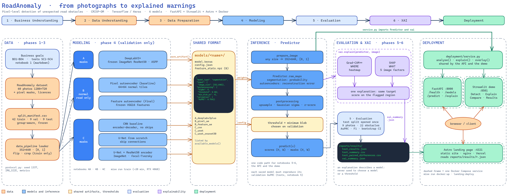

<!-- Source of the master notebook's opening cells (scripts/build_master_notebook.py reads it).
     Kept apart from the README so a README edit never changes the submitted notebook.
     Links are relative to notebooks/. -->

## Architecture

*Click the image for the full size. Editable source: [`docs/architecture/roadanomaly-architecture.excalidraw`](../docs/architecture/roadanomaly-architecture.excalidraw) (open it at [excalidraw.com](https://excalidraw.com), edit, then export a PNG over the one next to it).*

Two social-media versions of the architecture sit next to it: [`roadanomaly-stack.png`](../docs/architecture/roadanomaly-stack.png) (2160×2700, the stack with its technology icons, one container per CRISP-DM stage; generated by [`diagram_as_code.py`](../docs/architecture/diagram_as_code.py), which needs Playwright) and [`roadanomaly-linkedin.png`](../docs/architecture/roadanomaly-linkedin.png) (1080×1080 square, from [`roadanomaly-linkedin.html`](../docs/architecture/roadanomaly-linkedin.html)).

How to read it, left to right (the ribbon on top is the CRISP-DM phases; every box below is a file or module of this repository):
1. **Data.** The 60 RoadAnomaly photographs and masks go through the frozen, group-aware split (`splits/split_manifest.csv`) and the shared loader in `data_pipeline.py` (352×640, augmentation on the training images only).
2. **Modeling.** Three approaches, six models, all trained on the same loader and chosen on validation only: A DeepLabV3+; B pixel and feature autoencoders (trained on normal road only); C a CNN and two U-Nets.
3. **Shared format.** Training ends with `inference.save_artifact`, which writes one folder per model, `models/<name>/`, with `model.keras` and a `config.json` holding the input size, the post-processing settings and the threshold chosen on validation (the feature autoencoder adds `feature_stats.npz`).
4. **Inference.** One `Predictor` reads any of those folders: `prepare_image`, the model's raw score map, post-processing (upsample, Gaussian smoothing, per-image z-score), then the validation threshold and minimum blob size. The notebooks, the API and the demo all use this single code path.
5. **Evaluation and XAI.** Notebook 5 opens the test split once and writes `reports/results/`; notebook 6 explains every model with Grad-CAM++ (where) and exact SHAP over five image factors (what) and writes `xai_summary.json`.
6. **Deployment.** `deployment/service.py` imports the `Predictor` and `xai` and serves three front ends: the FastAPI service (`/health`, `/models`, `/predict`, `/explain`), the Streamlit technical demo (:8501) and the RoadAnomaly product, the customer MVP (:8502, `mise run product`). The Astro landing page is static and reads `reports/results/`. The four run as Docker Compose services (`mise run docker:up`); the landing page is also deployed to Vercel (`mise run landing:deploy`).

## TL;DR
**The problem.** A car's camera network knows a closed list of things: road, car, person, sign. Put a cow on the road and it still has to answer with one of its words, so it may call the cow "road". We want a network that says instead *"these pixels are something I did not expect"*: a mask that tells a driver-assistance system **where** the obstacle is and **how big**, without knowing **what** it is.

**What we did.** Six models from three ideas, trained on the same 42 photographs, chosen on the same 9 validation photographs, and judged **once** on 9 sealed test photographs (22 obstacles):
- **A, learn the masks with borrowed eyes:** DeepLabV3+ on a frozen ResNet50 that already learned to see on ImageNet.
- **B, learn only what a normal road looks like:** an autoencoder copies normal road; what it cannot copy is the alarm. First on pixels, then on VGG16 features.
- **C, learn the masks from scratch, then with borrowed eyes:** a CNN, a U-Net (skip connections keep the details), and a U-Net with an ImageNet ResNet50 encoder.

**What we found.**
1. **Three-way tie at the top.** DeepLabV3+ (F1 0.739), the pretrained U-Net (0.708) and the feature autoencoder (0.623) cannot be separated on 9 photographs (their paired 95 % intervals cross zero), and each beats the other three models.
2. **Pretrained ImageNet features are the dividing line.** The three models that see through an ImageNet network score F1 ≥ 0.62; the three that learned to see from our 42 photographs alone score ≤ 0.45. Even the autoencoder's success mostly comes from the VGG16 features: a model with no autoencoder at all, on the same features, scores about the same, and we say so.
3. **They fail differently, and that decides the use.** The supervised models find the most obstacles (20/22 for DeepLabV3+) but sprinkle small false alarms (38 of its 67 blobs). The feature autoencoder raises fewer, surer warnings (12 of 22 right) and is the **only model that passes all four business tests**.
4. **Every warning can be explained twice.** *Where* (Grad-CAM++, a flashlight on the image regions that raised the score; faithful for 5 of 6 models) and *what* (exact SHAP, a fair split of the score between five image factors). Brightness and contrast is the main factor for four models; DeepLabV3+ leans on the surrounding scene, the pixel autoencoder on the obstacle itself.
5. **Fast enough for video:** 13–48 ms per photograph on a laptop RTX 4060.

**Recommendation.** DeepLabV3+ by default (the API and the video script use it); the feature autoencoder where a false alarm is expensive. **Limits:** 9 test photographs (one photo moves a mean by about 11 %), no small obstacle in the test split, and RoadAnomaly is used here for both training and testing, so these are not out-of-distribution benchmark scores.
